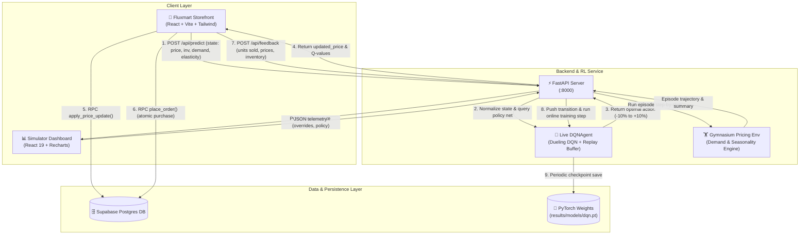

# Autonomous Dynamic Pricing Reinforcement Learning Ecosystem

An end-to-end, closed-loop dynamic pricing ecosystem combining Deep Reinforcement Learning (Dueling DQN with Layer Normalization), a Gymnasium simulation environment, an online continuous learning inference microservice, an interactive researcher simulation dashboard, and a live production-grade e-commerce storefront (**Fluxmart**).

---

## 📑 Table of Contents

- [Ecosystem Overview](#ecosystem-overview)
- [Architecture & Data Flow](#architecture--data-flow)
- [Repository Structure](#repository-structure)
- [System Components & Internal Documentation](#system-components--internal-documentation)
  - [1. RL Core Engine & FastAPI Service (`dynamic-pricing-RL/`)](#1-rl-core-engine--fastapi-service-dynamic-pricing-rl)
  - [2. Pricing Simulation Dashboard (`dynamic-pricing-RL/frontend/`)](#2-pricing-simulation-dashboard-dynamic-pricing-rlfrontend)
  - [3. Fluxmart Live E-Commerce Storefront (`fluxmart/`)](#3-fluxmart-live-e-commerce-storefront-fluxmart)
  - [4. Database & RPC Transaction Layer (`fluxmart/supabase/`)](#4-database--rpc-transaction-layer-fluxmartsupabase)
- [The Closed-Loop Online RL Lifecycle](#the-closed-loop-online-rl-lifecycle)
- [Quickstart: Running the Entire Setup](#quickstart-running-the-entire-setup)
  - [Step 1: Supabase Database Setup](#step-1-supabase-database-setup)
  - [Step 2: Start the RL & FastAPI Inference Engine](#step-2-start-the-rl--fastapi-inference-engine)
  - [Step 3: Start the RL Simulation Dashboard](#step-3-start-the-rl-simulation-dashboard)
  - [Step 4: Start the Fluxmart Storefront](#step-4-start-the-fluxmart-storefront)
  - [Step 5: Offline Model Training & Policy Benchmarking (Optional)](#step-5-offline-model-training--policy-benchmarking-optional)
- [Environment Variables & Configuration Matrix](#environment-variables--configuration-matrix)
- [API Reference Summary](#api-reference-summary)

---

## Ecosystem Overview

Dynamic pricing in e-commerce requires balancing inventory velocity, price elasticity of demand, seasonality cycles, holding costs, and profit margins. This project provides a complete production and research setup:

1. **Self-Optimizing Agent**: An RL agent powered by a custom **Dueling DQN** neural network with Layer Normalization that evaluates 7 market features and picks optimal price adjustments: `[-10%, -5%, hold, +5%, +10%]`.
2. **Offline Pretraining & Policy Evaluation**: A Gymnasium environment that models realistic demand dynamics via price elasticity curves, seasonality sine waves, and stochastic shocks. Evaluates policies against Random, Fixed, and Oracle benchmarks.
3. **Continuous Online Learning Microservice**: A FastAPI backend that retains the model, optimizer, and replay buffer in memory. When live customers checkout on the storefront, the purchase outcome is dispatched to the backend, enabling real-time online experience replay updates without restarting the model.
4. **Researcher Dashboard**: A React 19 + TypeScript + Recharts web app enabling researchers to tweak product parameters, run simulation episodes, and visualize demand, price, inventory depletion, and cumulative revenue in real-time.
5. **Live E-Commerce Storefront (Fluxmart)**: A React + Tailwind CSS web application powered by Supabase Auth and Database. Products display live prices generated by the DQN model, and completed purchases directly feed the online training loop.

---

## Architecture & Data Flow



---

## Repository Structure

```text
website-rl/
├── README.md                           # ← Global Ecosystem Overview (This File)
├── fluxmart_schema.sql                 # Standalone root SQL schema dump
├── fluxmart_seed.sql                   # Standalone root SQL seed data
│
├── dynamic-pricing-RL/                 # [Component 1] RL Engine, Training & FastAPI Backend
│   ├── README.md                       # Comprehensive RL Engine Documentation
│   ├── pyproject.toml                  # Python package configuration (uv / hatchling)
│   ├── uv.lock                         # Pinned dependency lockfile
│   ├── train.py                        # Offline DQN training script (1000 episodes)
│   ├── evaluate.py                     # Policy benchmarking (DQN vs Random vs Fixed vs Oracle)
│   ├── plot_demand_price.py            # Demand-price response curve visualizer
│   ├── configs/
│   │   └── default.yaml                # Default product parameters & environment settings
│   ├── results/
│   │   ├── dqn_policy.csv              # Exported policy action distribution
│   │   ├── training_log.csv            # Episode-by-episode training metrics
│   │   └── models/
│   │       └── dqn.pt                  # Pre-trained PyTorch model checkpoint
│   ├── src/dynamic_pricing/
│   │   ├── agent/                      # Dueling DQN, Replay Buffer, and DQNAgent
│   │   │   ├── agent.py                # DQNAgent with epsilon-greedy & continuous online update
│   │   │   ├── dqn.py                  # Dueling DQN architecture with LayerNorm
│   │   │   └── replay_buffer.py        # Cyclic replay memory (capacity: 50,000)
│   │   ├── api/                        # FastAPI application & HTTP contracts
│   │   │   ├── app.py                  # Endpoints: /predict, /feedback, /training-stats, /simulate
│   │   │   ├── policies.py             # Action policies (random, fixed, oracle, DQN)
│   │   │   └── schemas.py              # Pydantic input/output validation models
│   │   ├── environment/
│   │   │   └── pricing_env.py          # Gymnasium DynamicPricingEnv implementation
│   │   ├── models/
│   │   │   └── product.py              # Product dataclass & business constraint validation
│   │   └── simulation/
│   │       └── demand.py               # Deterministic + stochastic demand generation
│   ├── tests/                          # Automated test suite (pytest)
│   └── frontend/                       # [Component 2] Interactive Simulator Dashboard
│       ├── README.md                   # Dedicated Simulator Dashboard Documentation
│       ├── package.json                # React 19, TypeScript, Recharts
│       ├── vite.config.ts              # Vite configuration with /api proxy to :8000
│       └── src/                        # Dashboard UI components & state
│
└── fluxmart/                           # [Component 3] Live E-Commerce Storefront
    ├── README.md                       # Dedicated Fluxmart Storefront Documentation
    ├── package.json                    # React 18, Tailwind CSS, Supabase JS
    ├── vite.config.js                  # Vite configuration
    ├── tailwind.config.js              # Custom styling & retro aesthetic tokens
    ├── .env.example                    # Environment variable template
    ├── src/
    │   ├── App.jsx                     # Route declarations & provider nesting
    │   ├── api/
    │   │   └── pricingModel.js         # Integration client for /api/predict & /api/feedback
    │   ├── context/
    │   │   ├── AuthContext.jsx         # Supabase authentication session provider
    │   │   ├── CartContext.jsx         # Shopping cart state & checkout handler
    │   │   └── ProductsContext.jsx     # Live product catalog & repricing dispatcher
    │   ├── pages/                      # Landing, Shop, Cart, Orders, PricingLog, ModelInputs, About
    │   ├── components/                 # Navbar, Hero, ProductCard, ProductGrid, Modal, ProtectedRoute
    │   └── lib/                        # Supabase client & currency formatting (INR)
    └── supabase/                       # [Component 4] Database Migrations & Stored Procedures
        ├── schema.sql                  # Main schema (tables, RLS policies, triggers, RPCs)
        ├── seed.sql                    # Initial 5 catalog products
        ├── place_order.sql             # Atomic order placement & stock validation RPC
        ├── inventory_management.sql    # Inventory update & restocking stored procedures
        ├── migrate_inr.sql             # Currency conversion migration to INR (₹)
        └── update_prices_900_1500.sql  # Normalized price bracket adjustment script
```

---

## System Components & Internal Documentation

Each subsystem within this repository contains dedicated documentation explaining its inner workings, architectural decisions, and setup instructions:

### 1. RL Core Engine & FastAPI Service (`dynamic-pricing-RL/`)
- **Location**: [`dynamic-pricing-RL/`](file:///c:/Users/User/Documents/Adithya/College/College%20Year%203/Semester%201/AI/website-rl/dynamic-pricing-RL)
- **Detailed Documentation**: [`dynamic-pricing-RL/README.md`](file:///c:/Users/User/Documents/Adithya/College/College%20Year%203/Semester%201/AI/website-rl/dynamic-pricing-RL/README.md)
- **Primary Roles**:
  - Encapsulates the custom Gymnasium environment `DynamicPricingEnv`.
  - Implements the **Dueling DQN** neural network architecture (`dqn.py`) splitting states into Value $V(s)$ and Advantage $A(s, a)$ streams.
  - Houses the offline training loop (`train.py`) and multi-policy evaluation suite (`evaluate.py`).
  - Serves real-time inference via FastAPI on `http://127.0.0.1:8000`:
    - `POST /api/predict`: Returns dynamic pricing recommendations and Q-values based on 7-dimensional normalized state vectors.
    - `POST /api/feedback`: Ingests actual checkout events to run online mini-batch gradient updates.
    - `GET /api/training-stats`: Exposes real-time agent metrics ($\epsilon$, step count, replay buffer size, loss).

### 2. Pricing Simulation Dashboard (`dynamic-pricing-RL/frontend/`)
- **Location**: [`dynamic-pricing-RL/frontend/`](file:///c:/Users/User/Documents/Adithya/College/College%20Year%203/Semester%201/AI/website-rl/dynamic-pricing-RL/frontend)
- **Detailed Documentation**: [`dynamic-pricing-RL/frontend/README.md`](file:///c:/Users/User/Documents/Adithya/College/College%20Year%203/Semester%201/AI/website-rl/dynamic-pricing-RL/frontend/README.md)
- **Primary Roles**:
  - React 19 + Vite + TypeScript web interface tailored for machine learning researchers and system operators.
  - Full control over simulation parameters (initial inventory, price floor/ceiling, base demand, price elasticity, seasonality period, and demand noise).
  - Visual comparison of action policies (`random`, `greedy`, `fixed`, `oracle`).
  - Interactive Recharts visualizers:
    - Price & Demand trajectories with reference price boundaries.
    - Per-step and Cumulative Revenue curves.
    - Inventory depletion timelines.
    - Searchable step-by-step episode telemetry logs.

### 3. Fluxmart Live E-Commerce Storefront (`fluxmart/`)
- **Location**: [`fluxmart/`](file:///c:/Users/User/Documents/Adithya/College/College%20Year%203/Semester%201/AI/website-rl/fluxmart)
- **Detailed Documentation**: [`fluxmart/README.md`](file:///c:/Users/User/Documents/Adithya/College/College%20Year%203/Semester%201/AI/website-rl/fluxmart/README.md)
- **Primary Roles**:
  - Consumer-facing e-commerce store with an expressive retro editorial aesthetic (pill navigation, bright lime grid, tilted polaroid photography).
  - Real-time dynamic repricing: Fetches dynamic price recommendations for catalog items on load and shop visits.
  - End-to-end shopping workflow: User signup/login, product catalog browsing, cart drawer, and checkout.
  - Transaction-level RL feedback: Dispatching completed purchase metrics to `VITE_DQN_FEEDBACK_URL` so the model continuously learns from real buyer behavior.
  - Administrative transparency:
    - **Pricing Log (`/pricing-log`)**: Immutable audit history of price fluctuations, percentage changes, and timestamps.
    - **Model Inputs (`/model-inputs`)**: Protected admin interface to inspect and calibrate product features (elasticity, seasonality, demand velocity, inventory).

### 4. Database & RPC Transaction Layer (`fluxmart/supabase/`)
- **Location**: [`fluxmart/supabase/`](file:///c:/Users/User/Documents/Adithya/College/College%20Year%203/Semester%201/AI/website-rl/fluxmart/supabase)
- **Primary Roles**:
  - **Row Level Security (RLS)**: Enforces least-privilege security. Clients cannot directly update prices or inventories.
  - **`apply_price_update(product_id, new_price, source)`**: Stored procedure ensuring price updates and `price_history` audit logs execute in a single atomic transaction.
  - **`apply_product_inputs(...)`**: Stored procedure updating product parameters while snapshotting historical entries in `demand_metrics`.
  - **`place_order(p_items)`**: Atomic checkout procedure validating available inventory under row locks (`FOR UPDATE`), deducting stock, creating order headers, and populating line items.

---

## The Closed-Loop Online RL Lifecycle

The fundamental innovation of this architecture is the **closed-loop continuous learning cycle**:

```text
[Supabase DB / Admin]
       │
       ▼ (1) Product State: [price, inventory, demand, elasticity, seasonality, velocity]
[FastAPI /api/predict]
       │
       ▼ (2) Min-Max Normalization & Dueling DQN forward pass
[Recommended Price Action] ──> (3) apply_price_update() RPC ──> [Storefront Displays Price]
                                                                        │
                                                                        ▼ (4) Customer Buys
                                                                 [place_order() RPC]
                                                                        │
                                                                        ▼ (5) Checkout Event
                                                                 [confirmPriceApplied()]
                                                                        │
                                                                        ▼
                                                             [FastAPI /api/feedback]
                                                                        │
       ┌────────────────────────────────────────────────────────────────┘
       ▼
[Reward Calculation]: reward = (profit + zero_sale_penalty) / initial_price
       │
       ▼
[ReplayBuffer.push(s, a, r, s', done)]
       │
       ▼
[Mini-Batch Gradient Step]: Policy Net loss optimization & periodic Target Net update
       │
       ▼
[Model Checkpoint]: Auto-saved to results/models/dqn.pt
```

---

## Quickstart: Running the Entire Setup

Follow these steps to spin up the complete ecosystem on your local machine.

### Prerequisites

- **Python**: Version 3.10 or higher
- **uv**: Fast Python package manager ([Astral uv](https://docs.astral.sh/uv/))
- **Node.js**: Version 18.0.0 or higher (with `npm`)
- **Supabase Account**: A free Supabase project ([supabase.com](https://supabase.com))

---

### Step 1: Supabase Database Setup

1. Log into your Supabase Dashboard and create a new project.
2. In the Supabase **SQL Editor**, open and execute in order:
   - [`fluxmart/supabase/schema.sql`](file:///c:/Users/User/Documents/Adithya/College/College%20Year%203/Semester%201/AI/website-rl/fluxmart/supabase/schema.sql) — Core tables, RLS policies, triggers, and `apply_price_update`.
   - [`fluxmart/supabase/seed.sql`](file:///c:/Users/User/Documents/Adithya/College/College%20Year%203/Semester%201/AI/website-rl/fluxmart/supabase/seed.sql) — Starter catalog of 5 products.
   - [`fluxmart/supabase/place_order.sql`](file:///c:/Users/User/Documents/Adithya/College/College%20Year%203/Semester%201/AI/website-rl/fluxmart/supabase/place_order.sql) — Transactional checkout stored procedure.
   - *(Optional)* [`fluxmart/supabase/update_prices_900_1500.sql`](file:///c:/Users/User/Documents/Adithya/College/College%20Year%203/Semester%201/AI/website-rl/fluxmart/supabase/update_prices_900_1500.sql) — Normalizes prices into the ₹900–₹1,500 range.
3. Under **Authentication → Settings**, turn off **"Confirm email"** for seamless local testing.
4. Retrieve your **Project URL** and **anon public key** from **Project Settings → API**.

---

### Step 2: Start the RL & FastAPI Inference Engine

The backend handles model loading, prediction requests, and online learning:

```bash
# Navigate to the RL engine directory
cd dynamic-pricing-RL

# Install all Python dependencies via uv
uv sync

# Launch the FastAPI server on port 8000
uv run uvicorn dynamic_pricing.api.app:app --reload --port 8000
```

- **Health check**: [http://127.0.0.1:8000/api/health](http://127.0.0.1:8000/api/health)
- **Interactive Swagger Docs**: [http://127.0.0.1:8000/docs](http://127.0.0.1:8000/docs)

---

### Step 3: Start the RL Simulation Dashboard

In a separate terminal window:

```bash
cd dynamic-pricing-RL/frontend
npm install
npm run dev
```

- Open [http://localhost:5173](http://localhost:5173) in your browser.
- Run test episodes, alter product demand parameters, and observe the policy trajectories.

---

### Step 4: Start the Fluxmart Storefront

In a third terminal window:

```bash
cd fluxmart

# Copy environment variable template
cp .env.example .env
```

Edit `fluxmart/.env` with your Supabase credentials:

```ini
VITE_SUPABASE_URL=https://your-project.supabase.co
VITE_SUPABASE_ANON_KEY=your-anon-key
VITE_DQN_PREDICT_URL=http://localhost:8000/api/predict
VITE_DQN_FEEDBACK_URL=http://localhost:8000/api/feedback
VITE_DQN_STATS_URL=http://localhost:8000/api/training-stats
```

Install and launch the storefront (Vite runs on port 5174 if 5173 is occupied):

```bash
npm install
npm run dev
```

- Navigate to the storefront URL printed by Vite (typically [http://localhost:5174](http://localhost:5174) or [http://localhost:5173](http://localhost:5173)).
- Sign up for a demo account.
- Browse the catalog, add products to cart, and place an order to trigger the closed-loop feedback mechanism!

---

### Step 5: Offline Model Training & Policy Benchmarking (Optional)

To train a new DQN policy from scratch or benchmark policies:

```bash
cd dynamic-pricing-RL

# Run 1000 offline training episodes:
uv run python train.py

# Evaluate DQN against Fixed, Random, and Oracle benchmarks:
uv run python evaluate.py

# Plot state-action demand/price curves:
uv run python plot_demand_price.py
```

Training telemetry is saved to `results/training_log.csv`, model weights are saved to `results/models/dqn.pt`, and policy benchmarks are saved to `results/dqn_policy.csv`.

---

## Environment Variables & Configuration Matrix

| File | Variable | Default / Example | Purpose |
|------|----------|-------------------|---------|
| `fluxmart/.env` | `VITE_SUPABASE_URL` | `https://xyz.supabase.co` | Supabase project API gateway |
| `fluxmart/.env` | `VITE_SUPABASE_ANON_KEY` | `eyJhbG...` | Public anonymous Supabase key |
| `fluxmart/.env` | `VITE_DQN_PREDICT_URL` | `http://localhost:8000/api/predict` | Dynamic pricing recommendation endpoint |
| `fluxmart/.env` | `VITE_DQN_FEEDBACK_URL` | `http://localhost:8000/api/feedback` | Post-purchase online learning endpoint |
| `fluxmart/.env` | `VITE_DQN_STATS_URL` | `http://localhost:8000/api/training-stats` | Real-time RL training telemetry endpoint |
| `dynamic-pricing-RL/configs/default.yaml` | `product.initial_price` | `1000.0` | Default baseline price for simulator |
| `dynamic-pricing-RL/configs/default.yaml` | `product.minimum_price` | `500.0` | Lower price clamping boundary |
| `dynamic-pricing-RL/configs/default.yaml` | `product.maximum_price` | `2000.0` | Upper price clamping boundary |
| `dynamic-pricing-RL/configs/default.yaml` | `environment.max_steps` | `100` | Timesteps per simulation episode |

---

## API Reference Summary

The FastAPI service exposes the following endpoints:

| Method | Endpoint | Description | Request Payload | Response |
|--------|----------|-------------|-----------------|----------|
| `GET` | `/api/health` | Health check and live agent status | None | `{"status": "ok", "model_loaded": true, "online_steps": int}` |
| `POST` | `/api/predict` | DQN price action prediction | `PredictRequest` (7 state features) | `PredictResponse` (action, updated price, Q-values) |
| `POST` | `/api/feedback` | Online learning checkout feedback | `FeedbackRequest` (units sold, prices, state) | `FeedbackResponse` (buffer size, steps, loss, epsilon) |
| `GET` | `/api/training-stats` | Live training statistics | None | `TrainingStatsResponse` (steps, loss, epsilon, buffer) |
| `GET` | `/api/config` | Default simulation parameters & policies | None | `dict` (product, env, policies, action labels) |
| `POST` | `/api/simulate` | Full episode simulation run | `SimulateRequest` (overrides, policy, seed) | `SimulateResponse` (summary, step-by-step logs) |

---

## Key Documentation Links

- 🔗 **RL Core Engine**: [`dynamic-pricing-RL/README.md`](file:///c:/Users/User/Documents/Adithya/College/College%20Year%203/Semester%201/AI/website-rl/dynamic-pricing-RL/README.md)
- 🔗 **Simulation Dashboard**: [`dynamic-pricing-RL/frontend/README.md`](file:///c:/Users/User/Documents/Adithya/College/College%20Year%203/Semester%201/AI/website-rl/dynamic-pricing-RL/frontend/README.md)
- 🔗 **Fluxmart Storefront**: [`fluxmart/README.md`](file:///c:/Users/User/Documents/Adithya/College/College%20Year%203/Semester%201/AI/website-rl/fluxmart/README.md)
- 🔗 **Database Schema**: [`fluxmart/supabase/schema.sql`](file:///c:/Users/User/Documents/Adithya/College/College%20Year%203/Semester%201/AI/website-rl/fluxmart/supabase/schema.sql)
