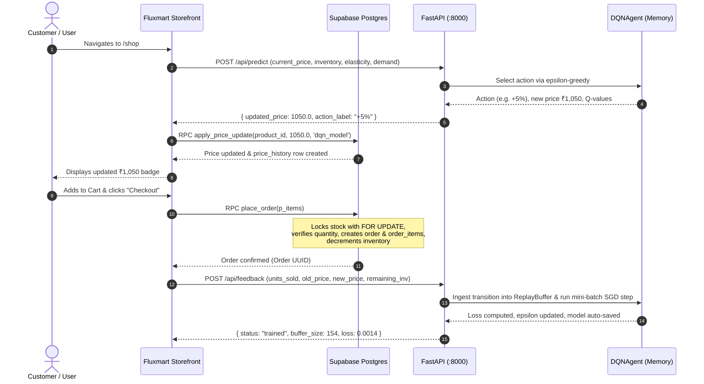

# Fluxmart — Live E-Commerce Storefront & Real-World RL Testbed

> **Component:** Production-Grade Storefront & Live RL Integration  
> **Ecosystem:** [Dynamic Pricing RL Ecosystem](../README.md)  
> **ML Engine Counterpart:** [dynamic-pricing-RL Backend](../dynamic-pricing-RL/README.md)  
> **Simulation Sandbox Counterpart:** [Simulator Dashboard](../dynamic-pricing-RL/frontend/README.md)

**Fluxmart** is a modern e-commerce storefront featuring an expressive retro-editorial design, end-to-end shopping and checkout workflows, and full **real-time integration with the Dueling DQN dynamic pricing engine**. 

Prices across the storefront dynamically adjust based on live model recommendations, and completed customer purchases directly feed the model's **online continuous learning loop**.

---

## 📑 Table of Contents

- [Component Role in Ecosystem](#component-role-in-ecosystem)
- [Key Features](#key-features)
- [Architecture & Tech Stack](#architecture--tech-stack)
- [Directory Structure](#directory-structure)
- [The Dynamic Pricing & Online Feedback Lifecycle](#the-dynamic-pricing--online-feedback-lifecycle)
  - [1. Real-Time Price Recommendation (`/api/predict`)](#1-real-time-price-recommendation-apipredict)
  - [2. Atomic Price Update (`apply_price_update`)](#2-atomic-price-update-apply_price_update)
  - [3. Transactional Checkout (`place_order`)](#3-transactional-checkout-place_order)
  - [4. Closed-Loop Feedback Dispatch (`/api/feedback`)](#4-closed-loop-feedback-dispatch-apifeedback)
- [Administrative & Auditing Interfaces](#administrative--auditing-interfaces)
  - [Live Pricing Log (`/pricing-log`)](#live-pricing-log-pricing-log)
  - [Model Inputs Calibration (`/model-inputs`)](#model-inputs-calibration-model-inputs)
- [Database Architecture & SQL Scripts](#database-architecture--sql-scripts)
- [Setup & Running Locally](#setup--running-locally)
- [Environment Variables](#environment-variables)
- [Production Deployment](#production-deployment)

---

## Component Role in Ecosystem

Fluxmart serves as the **operational frontier** of the dynamic pricing ecosystem:
- Rather than leaving reinforcement learning models trapped in offline simulations, Fluxmart puts the DQN agent in front of real user sessions.
- Catalog prices are continually proposed by the DQN model based on current inventory, velocity, seasonality, and price elasticity.
- Buyer purchase decisions (units purchased at the offered price) generate ground-truth transaction rewards that are delivered back to the RL engine to guide online policy adaptation.

---

## Key Features

- **Distinctive Editorial Aesthetic**: Custom design featuring floating white pill navigation, neon lime accent canvas, tilted polaroid-style product cards, retro badges, and playful hero doodles.
- **Dynamic Pricing Integration**: Fully connected to the Python FastAPI microservice to fetch price recommendations and display live price movements.
- **End-to-End E-Commerce Flow**:
  - Full product browsing with category tags.
  - Interactive Add-to-Cart modal with quantity selectors and stock awareness.
  - Cart drawer with subtotal calculations and stock availability checks.
  - Customer Order History page (`/orders`) displaying paid orders and item breakdowns.
- **Enterprise-Grade Database Security**:
  - Supabase Authentication with session management in `AuthContext`.
  - Row Level Security (RLS) policies preventing unauthenticated tampering.
  - Security-definer stored procedures ensuring that price mutations, inventory updates, and order placements are executed as atomic database transactions.
- **Auditability & Observability**:
  - **Live Pricing Log (`/pricing-log`)**: Complete chronological audit trail of all price adjustments, old vs. new values, percentage deltas, and triggering sources.
  - **Model Inputs Manager (`/model-inputs`)**: Protected admin dashboard to inspect and fine-tune per-product demand parameters (seasonality, velocity, elasticity, stock).

---

## Architecture & Tech Stack

| Layer | Technology | Purpose |
|-------|------------|---------|
| **Frontend Framework** | React 18 (`^18.3.1`) | Component architecture, state hooks, and routing |
| **Routing** | React Router DOM (`^6.26.2`) | Client-side routing with protected route guards |
| **Styling** | Tailwind CSS (`^3.4.13`) | Custom palette, typography, responsive grid layouts |
| **Backend as a Service** | Supabase (`^2.45.4`) | Postgres DB, Auth, Realtime, and Stored Procedures |
| **Currency Formatter** | `Intl.NumberFormat` | Consistent Indian Rupee formatting (`₹999.00`) |
| **Build Tool** | Vite (`^5.4.8`) | Fast module bundler and local development server |

---

## Directory Structure

```text
fluxmart/
├── README.md                           # ← This File
├── package.json                        # Dependencies, scripts, and build metadata
├── vite.config.js                      # Vite bundler configuration
├── tailwind.config.js                  # Custom retro aesthetic styling tokens
├── postcss.config.js                   # PostCSS pipeline plugins
├── index.html                          # Storefront root HTML document
├── .env.example                        # Template for required environment variables
├── src/
│   ├── main.jsx                        # Application root entry point
│   ├── App.jsx                         # Top-level router and context provider tree
│   ├── index.css                       # Global styles and Tailwind directives
│   ├── api/
│   │   └── pricingModel.js             # HTTP client for DQN /predict, /feedback, & /stats
│   ├── context/
│   │   ├── AuthContext.jsx             # Supabase user authentication and session management
│   │   ├── CartContext.jsx             # Shopping cart state, quantity controls, and checkout
│   │   └── ProductsContext.jsx         # Catalog cache, live repricing, and Supabase polling
│   ├── components/
│   │   ├── Navbar.jsx                  # Floating pill navigation bar with cart indicator
│   │   ├── Hero.jsx                    # Retro headline hero with polaroid photography
│   │   ├── HeroDoodles.jsx             # Handcrafted vector accent doodles
│   │   ├── ProductCard.jsx             # Individual product polaroid card with price tags
│   │   ├── ProductGrid.jsx             # Responsive product showcase grid
│   │   ├── AddToCartModal.jsx          # Quick-buy modal dialog with quantity stepper
│   │   ├── ProtectedRoute.jsx          # Auth-guard protecting private routes
│   │   └── Footer.jsx                  # Storefront footer and attribution
│   ├── pages/
│   │   ├── Landing.jsx                 # High-impact home page with featured products
│   │   ├── Shop.jsx                    # Full catalog with dynamic repricing triggers
│   │   ├── Cart.jsx                    # Shopping cart summary and checkout execution
│   │   ├── Orders.jsx                  # Customer past orders and receipt view
│   │   ├── PricingLog.jsx              # Audit table of historical price movements
│   │   ├── ModelInputs.jsx             # Administrative demand parameter tuning form
│   │   ├── Login.jsx                   # User authentication sign-in page
│   │   ├── Signup.jsx                  # New user registration page
│   │   └── About.jsx                   # Project background and methodology details
│   └── lib/
│       ├── supabaseClient.js           # Supabase client instantiation
│       └── formatINR.js                # Indian Rupee currency formatting utility
└── supabase/
    ├── schema.sql                      # Base schema (tables, RLS policies, triggers, RPCs)
    ├── seed.sql                        # Catalog seed data (5 starter products)
    ├── place_order.sql                 # Atomic checkout stored procedure
    ├── inventory_management.sql        # Inventory decrement and restock stored procedures
    ├── migrate_inr.sql                 # Price migration to Indian Rupee (₹)
    └── update_prices_900_1500.sql      # Standardized price band alignment
```

---

## The Dynamic Pricing & Online Feedback Lifecycle



### 1. Real-Time Price Recommendation (`/api/predict`)
In `src/api/pricingModel.js`, `getRepricingSuggestion(product)` compiles a 7-dimensional feature vector from the product record and dispatches it to `VITE_DQN_PREDICT_URL`:

```json
{
  "current_price": 999.00,
  "remaining_inventory": 42,
  "historical_demand": 120.0,
  "current_demand": 145.0,
  "seasonality": 1.1,
  "price_elasticity": 1.35,
  "demand_velocity": 0.18
}
```

The model returns `updated_price` along with Q-value distributions.

### 2. Atomic Price Update (`apply_price_update`)
Clients have **no direct SQL `UPDATE` grant** on the `products` table. Price updates must call the `apply_price_update` Postgres function:
- Mutates `products.current_price`.
- Inserts an immutable row into `price_history`.
- Both operations succeed or fail together in a single transaction.

### 3. Transactional Checkout (`place_order`)
When a customer confirms their cart:
- `place_order(p_items)` is called via `supabase.rpc('place_order', ...)`.
- Rows in `products` are locked using `SELECT ... FOR UPDATE` to prevent race conditions.
- Stock is verified against requested quantities. If any product is out of stock, the transaction rolls back cleanly.
- An `orders` row (status: `'paid'`) and corresponding `order_items` records are created, and inventory counts are decremented.

### 4. Closed-Loop Feedback Dispatch (`/api/feedback`)
Immediately following a successful order, `confirmPriceApplied()` posts the transaction telemetry to `VITE_DQN_FEEDBACK_URL`. The agent updates its experience replay buffer and executes an online training step, ensuring that pricing decisions evolve with customer willingness-to-pay.

---

## Administrative & Auditing Interfaces

### Live Pricing Log (`/pricing-log`)
- Protected route accessible to logged-in users.
- Displays a real-time audit log of all pricing shifts across the catalog.
- Highlights old price, new price, percentage delta badges, triggering source (`dqn_model` vs `manual`), and exact timestamp.

### Model Inputs Calibration (`/model-inputs`)
- Protected route for system operators to adjust underlying demand parameters.
- Features editable fields:
  - Inventory Count
  - Seasonality Multiplier
  - Historical Baseline Demand
  - Real-Time Observed Demand
  - Price Elasticity ($\epsilon$)
  - Demand Velocity
- Submitting updates executes `apply_product_inputs(...)`, updating the active product and persisting a point-in-time entry to `demand_metrics`.

---

## Database Architecture & SQL Scripts

The `supabase/` directory contains all SQL declarations required to power the backend:

| Script | Purpose |
|--------|---------|
| [`schema.sql`](supabase/schema.sql) | Complete database DDL: `profiles`, `products`, `price_history`, `demand_metrics`, `model_requests_log`, `orders`, `order_items`, RLS policies, and core functions. |
| [`seed.sql`](supabase/seed.sql) | Populates the initial catalog of 5 retro-curated demo products. |
| [`place_order.sql`](supabase/place_order.sql) | Transaction-safe checkout RPC with inventory verification and stock deduction. |
| [`inventory_management.sql`](supabase/inventory_management.sql) | Additional stored procedures for stock replenishment and adjustments. |
| [`migrate_inr.sql`](supabase/migrate_inr.sql) | Schema and product migration to Indian Rupee (₹) pricing conventions. |
| [`update_prices_900_1500.sql`](supabase/update_prices_900_1500.sql) | Aligns catalog prices into the realistic ₹900–₹1,500 range. |

---

## Setup & Running Locally

### 1. Prerequisites
- Node.js ≥ 18.0.0
- Running [dynamic-pricing-RL backend](../dynamic-pricing-RL/README.md) on `http://localhost:8000`
- Active Supabase project

### 2. Configure Database
In your Supabase project's SQL Editor, execute in sequence:
1. `supabase/schema.sql`
2. `supabase/seed.sql`
3. `supabase/place_order.sql`

*(Under Authentication → Settings, disable "Confirm email" for frictionless local testing).*

### 3. Install Dependencies & Configure Environment
```bash
cd fluxmart
npm install
cp .env.example .env
```

Edit `.env` with your Supabase credentials:

```ini
VITE_SUPABASE_URL=https://your-project.supabase.co
VITE_SUPABASE_ANON_KEY=your-supabase-anon-key
VITE_DQN_PREDICT_URL=http://localhost:8000/api/predict
VITE_DQN_FEEDBACK_URL=http://localhost:8000/api/feedback
VITE_DQN_STATS_URL=http://localhost:8000/api/training-stats
```

### 4. Start Development Server
```bash
npm run dev
```

Open the browser at the printed address (default: [http://localhost:5173](http://localhost:5173) or [http://localhost:5174](http://localhost:5174)).

---

## Environment Variables

| Variable | Required | Description |
|----------|:--------:|-------------|
| `VITE_SUPABASE_URL` | **Yes** | Your Supabase project URL (found in Project Settings → API) |
| `VITE_SUPABASE_ANON_KEY` | **Yes** | Supabase anonymous public API key |
| `VITE_DQN_PREDICT_URL` | **Yes** | Endpoint where Fluxmart requests model repricing (`/api/predict`) |
| `VITE_DQN_FEEDBACK_URL` | **Yes** | Endpoint receiving checkout telemetry for online learning (`/api/feedback`) |
| `VITE_DQN_STATS_URL` | No | Optional telemetry endpoint providing live training metrics (`/api/training-stats`) |

---

## Production Deployment

Fluxmart is a static Single Page Application (SPA) compatible with any static hosting platform (Vercel, Netlify, Cloudflare Pages, AWS S3/CloudFront).

```bash
npm run build
```

The output bundle is compiled into the `dist/` directory. Ensure the production environment variables (`VITE_SUPABASE_*` and `VITE_DQN_*`) are configured in your hosting provider's dashboard.
